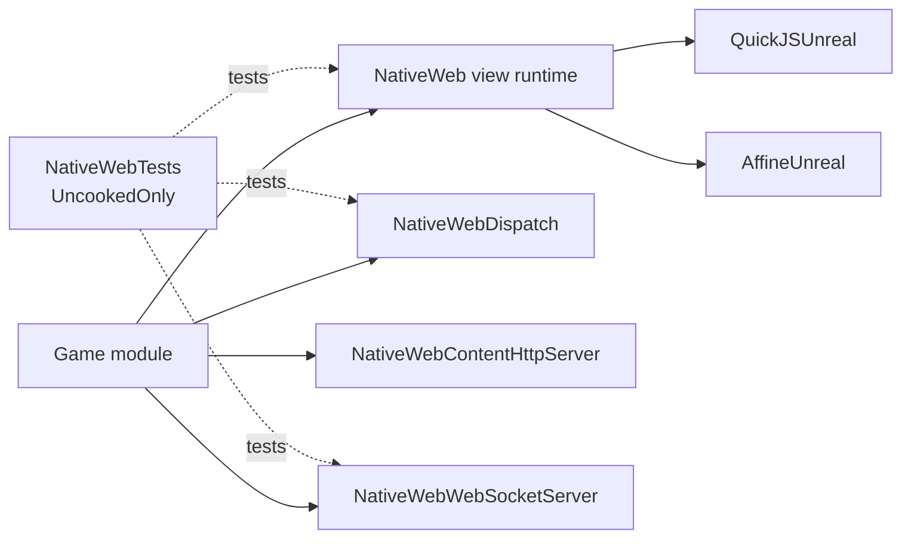

<p align="center">
  
</p>

<h1 align="center">NativeWeb for Unreal Engine</h1>

<p align="center">
  Native UI views and networking modules for Unreal Engine projects.
</p>

<p align="center">
  <a href="https://github.com/ArtemIyX/NativeWebUnreal"></a>
  <a href="https://github.com/ArtemIyX/NativeWebUnreal/issues"></a>
  <a href="NativeWeb.uplugin"></a>
  <a href="LICENSE"></a>
  
</p>

NativeWeb is an Unreal Engine plugin organized as five modules. Use the
`NativeWeb` module to embed a local HTML/CSS/JavaScript view in a player's
viewport and exchange opaque strings or bytes with its JavaScript runtime. The
other runtime modules provide independent dispatch, image HTTP, and WebSocket
services.

This repository is a fork of [WebUserInterfaceUnreal](https://github.com/ArtemIyX/WebUserInterfaceUnreal).

## Features

- **Reusable native views:** create, find, show, hide, attach, detach, resize,
  forward input, access the output texture, and explicitly close a view.
- **Packaged project content:** load `ui.css`, `ui.js`, and supported fonts from
  the project's `Content` directory. The packaged workflow creates its own
  HTML shell with an `#app` element; it does not require `index.html`.
- **Two-way JavaScript messaging:** exchange copied string and byte payloads
  through `globalThis.nativeWeb`, with channel labels, bounded queues, and
  C++ message/error delegates.
- **Exact-key typed dispatch:** register route factories and typed handlers
  without imposing a serialization format.
- **Content image HTTP service:** serve image responses through a game-instance
  subsystem and replaceable request handlers.
- **WebSocket servers:** manage named servers and clients through a staged
  network pipeline, built-in payload codecs, and game-thread events.
- **Uncooked automation coverage:** keep plugin tests in an `UncookedOnly`
  module outside cooked Shipping targets.

## Modules

| Module | Responsibility | Module README |
| --- | --- | --- |
| `NativeWeb` | AffineUI/QuickJS local-player views, viewport input, assets, and two-way messages | [NativeWeb runtime](Source/NativeWeb/README.md) |
| `NativeWebDispatch` | Exact route keys, value decoders, and typed handler registries | [Dispatch](Source/NativeWebDispatch/README.md) |
| `NativeWebContentHttpServer` | Game-instance image HTTP service, cache, and request handlers | [Content HTTP server](Source/NativeWebContentHttpServer/README.md) |
| `NativeWebWebSocketServer` | Game-instance WebSocket servers, clients, and message pipeline | [WebSocket server](Source/NativeWebWebSocketServer/README.md) |
| `NativeWebTests` | Uncooked automation tests for plugin modules | [Automation tests](Source/NativeWebTests/README.md) |

The modules are enabled independently in `NativeWeb.uplugin`. Starting one
module's subsystem does not start another module's services.

## Dependency plugins

NativeWeb requires these plugins to provide its embedded web runtime:

| Plugin | Responsibility | Repository |
| --- | --- | --- |
| `AffineUnreal` | AffineUI rendering, native surfaces, and D3D11/D3D12 presentation support | [ArtemIyX/AffineUnreal](https://github.com/ArtemIyX/AffineUnreal) |
| `QuickJSUnreal` | Embedded JavaScript execution for packaged scripts, DOM updates, and messaging | [ArtemIyX/QuickJSUnreal](https://github.com/ArtemIyX/QuickJSUnreal) |



## Quick start: create a packaged view

Enable the plugin and its `AffineUnreal` and `QuickJSUnreal` dependencies in
the project. Put the packaged UI under `Content/NativeWeb/Hud/`:

```text
Content/NativeWeb/Hud/
├── ui.css
├── ui.js
└── fonts/        (optional .ttf / .otf files)
```

Add `NativeWeb` to the consuming module's `Build.cs` dependencies, then create
the view from the local-player subsystem:

```cpp
#include "NativeWeb.h"
#include "Subsystems/NativeWebLocalPlayerSubsystem.h"

UNativeWebView* CreateHudView(ULocalPlayer* LocalPlayer)
{
    if (!LocalPlayer)
    {
        UE_LOG(LogNativeWeb, Error, TEXT("A local player is required."));
        return nullptr;
    }

    UNativeWebLocalPlayerSubsystem* NativeWeb =
        LocalPlayer->GetSubsystem<UNativeWebLocalPlayerSubsystem>();
    if (!NativeWeb)
    {
        UE_LOG(LogNativeWebSubsystem, Error, TEXT("NativeWeb subsystem is unavailable."));
        return nullptr;
    }

    FNativeWebSurfaceConfig Surface;
    FNativeWebPresentationConfig Presentation;
    FNativeWebError Error;
    UNativeWebView* View = NativeWeb->CreatePackagedView(
        FName(TEXT("Hud")), TEXT("NativeWeb/Hud"), Surface, Presentation, Error);
    if (!View)
    {
        UE_LOG(LogNativeWebSubsystem, Error, TEXT("View creation failed (%s): %s"),
            *Error.Code.ToString(), *Error.Message);
    }
    return View;
}
```

`CreatePackagedView` reads `ui.css`, evaluates `ui.js`, and creates the
`<div id="app"></div>` shell. Bundle the JavaScript needed at runtime into
`ui.js`; arbitrary URL navigation and ES module loading are not part of the
current view API. Use `FNativeWebSurfaceConfig` and
`FNativeWebPresentationConfig` to select size, DPI, presentation, fallback,
and z-order. For inline documents, use `CreateInlineView` with explicit HTML
and CSS. Full lifecycle, presentation, messaging, Blueprint, and local GPU
validation steps are in the [NativeWeb module README](Source/NativeWeb/README.md).

## Platform and runtime limits

The NativeWeb view backend currently requires **Win64 + D3D11 or D3D12**. AffineUI
permits **one live surface per process**; attempting to create another live
view fails clearly until the existing view is closed. QuickJS creation,
evaluation, message delivery, job pumping, and destruction belong to the game
thread. AffineUI surface and D3D11/D3D12 producer work runs on the RHI lane.

The view workflow reads packaged assets from the project's `Content`
directory; it does not access arbitrary filesystem paths from the RHI lane.
NativeWeb does not parse JSON/protobuf or impose an application-level message
schema. The modules are independent; see the table above for their individual
responsibilities and setup guides.

## Documentation

Each module README in the table above covers its module-specific setup and
API. Public headers contain the C++ API documentation.

## Tests

Automation tests live in `NativeWebTests`, an `UncookedOnly` module. The
QuickJS/AffineUI tests are guarded for Windows and the surface tests require a
D3D11 editor session. See the [NativeWebTests README](Source/NativeWebTests/README.md)
for test groups and invocation examples.

## License

NativeWeb is distributed under the [MIT License](LICENSE). See the license
file for the full terms.
